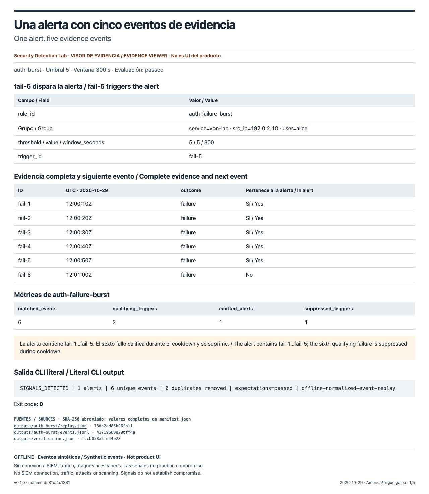
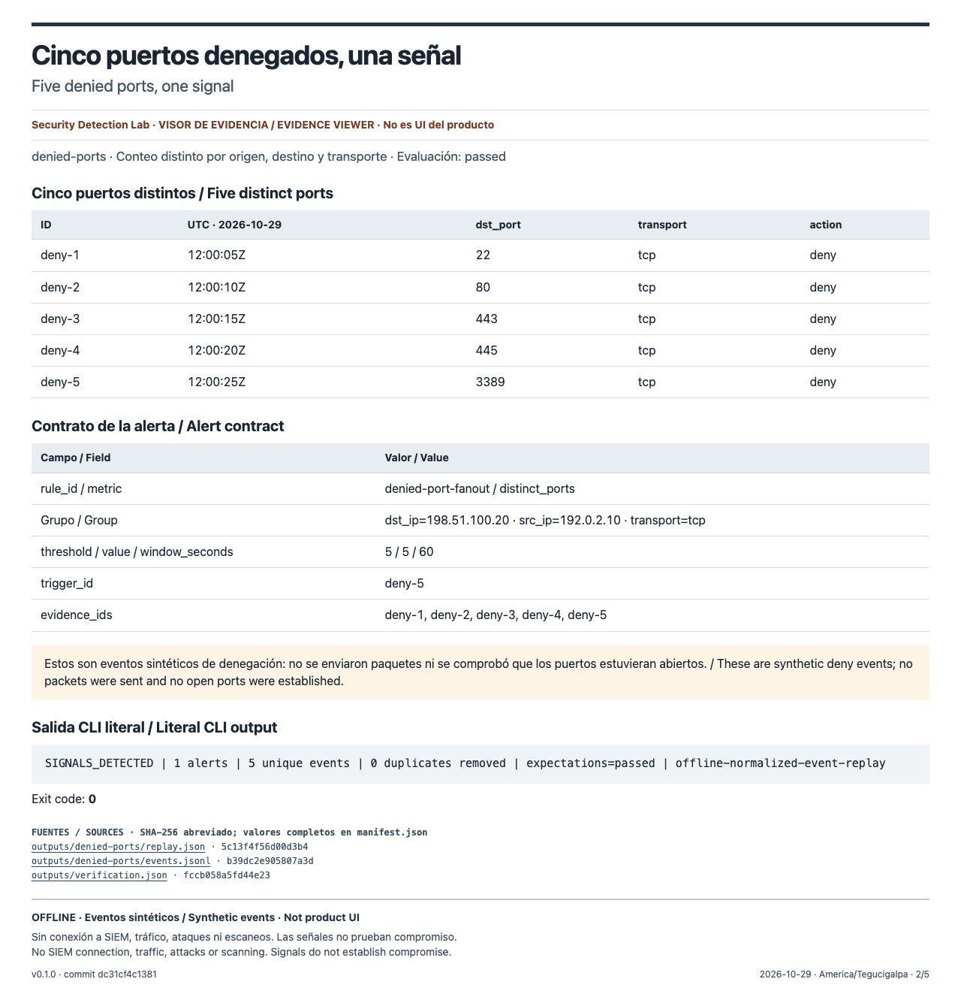
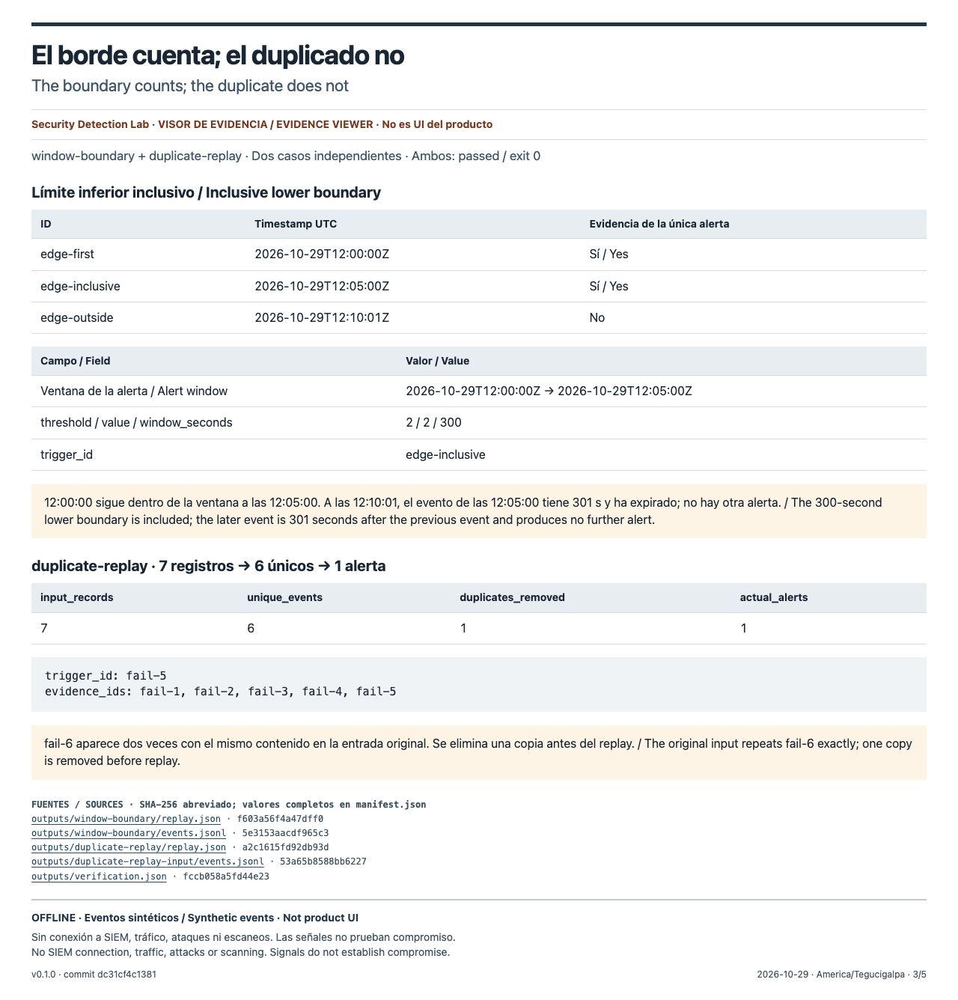
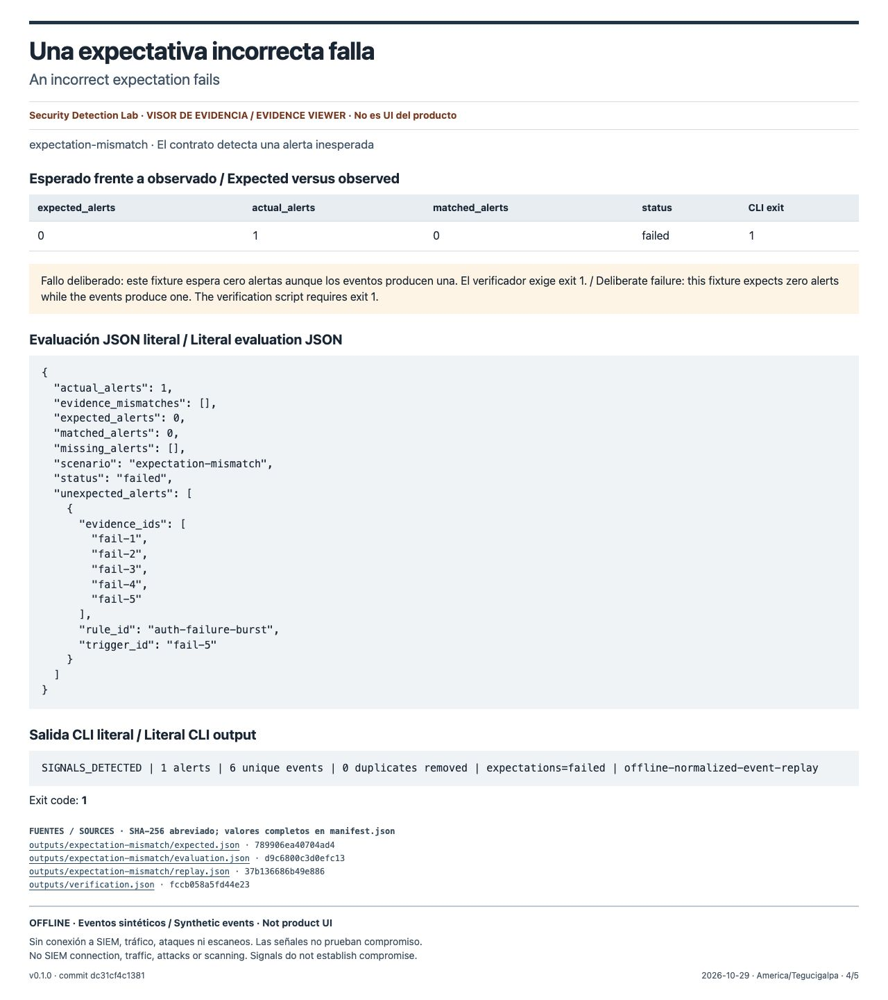
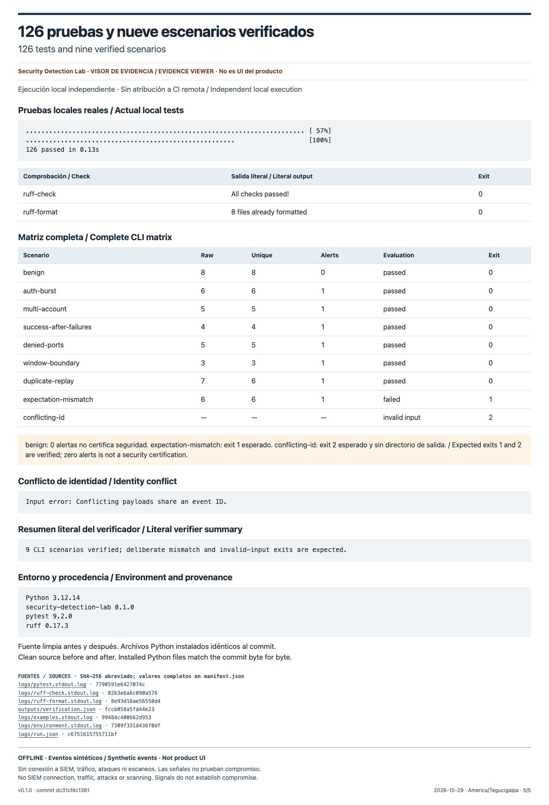

# Security Detection Lab — evidencia de ejecución / execution evidence

Paquete preparado para revisión de GitHub y portafolio. **Cinco capturas reales del navegador de un visor de evidencia; no es UI del producto ni una captura de Terminal.** El visor muestra resultados de una ejecución local independiente con eventos sintéticos offline. No hubo conexión a SIEM, ataques, escaneos ni generación de tráfico. Esta copia se integra en la documentación pública de la versión 0.1.0.

Prepared for GitHub and portfolio review. **Five actual browser screenshots of an evidence viewer; not product UI or Terminal screenshots.** The viewer presents an independent local execution using synthetic offline events. No SIEM connection, attacks, scanning or traffic generation took place. This copy is integrated into the public documentation for release 0.1.0.

- Proyecto / Project: [Security Detection Lab](https://github.com/carlosalpo/security-detection-lab), versión / version **0.1.0**.
- Fuente exacta / Exact source: [`dc31cf4c138123775185c41612e139082d383070`](https://github.com/carlosalpo/security-detection-lab/tree/dc31cf4c138123775185c41612e139082d383070).
- Fecha / Date: **2026-10-29**, America/Tegucigalpa. Command timestamps are recorded separately in UTC.
- Resultado / Result: **126 pruebas / tests; nueve escenarios / nine CLI scenarios; Ruff check y format check correctos / passed**.
- [Captions y textos alternativos ES + EN](captions.md) · [Índice del visor / Viewer index](viewer/index.html) · [Manifest](manifest.json) · [SHA256SUMS](SHA256SUMS).

## 1. Una alerta con cinco eventos de evidencia / One alert, five evidence events



**ES:** `auth-burst` emite una alerta con `fail-5` como disparador, cinco IDs de evidencia, umbral 5 y ventana de 300 s; suprime el sexto fallo durante el cooldown. Evaluación `passed`, salida 0.

**EN:** `auth-burst` emits one alert triggered by `fail-5`, with five evidence IDs, threshold 5 and a 300-second window; it suppresses the sixth failure during cooldown. Evaluation `passed`, exit 0.

[Replay JSON](outputs/auth-burst/replay.json) · [Eventos originales / Original events](outputs/auth-burst-input/events.jsonl) · [Visor / Viewer](viewer/01-auth-burst.html)

## 2. Cinco puertos denegados, una señal / Five denied ports, one signal



**ES:** `denied-port-fanout` cuenta los puertos 22, 80, 443, 445 y 3389; `deny-5` dispara la alerta. Son eventos sintéticos de denegación, sin escaneo ni demostración de puertos abiertos.

**EN:** `denied-port-fanout` counts ports 22, 80, 443, 445 and 3389; `deny-5` triggers the alert. These are synthetic deny events, without scanning or establishing that ports are open.

[Replay JSON](outputs/denied-ports/replay.json) · [Eventos / Events](outputs/denied-ports-input/events.jsonl) · [Visor / Viewer](viewer/02-denied-ports.html)

## 3. El borde cuenta; el duplicado no / The boundary counts; the duplicate does not



**ES:** El límite inferior de 300 s es inclusivo en `window-boundary`, con umbral 2. `duplicate-replay` elimina una copia exacta de `fail-6`: 7 registros → 6 eventos únicos → 1 alerta. Son dos pruebas independientes.

**EN:** The 300-second lower boundary is inclusive in `window-boundary`, with threshold 2. `duplicate-replay` removes one exact copy of `fail-6`: 7 records → 6 unique events → 1 alert. These are two independent cases.

[Window replay](outputs/window-boundary/replay.json) · [Duplicate input](outputs/duplicate-replay-input/events.jsonl) · [Duplicate replay](outputs/duplicate-replay/replay.json) · [Visor / Viewer](viewer/03-window-and-duplicates.html)

## 4. Una expectativa incorrecta falla / An incorrect expectation fails



**ES:** El fixture espera cero alertas y produce una. `failed` y la salida 1 son los resultados deliberados exigidos por el verificador.

**EN:** The fixture expects zero alerts and produces one. `failed` and exit 1 are the deliberate outcomes required by the verifier.

[Expectativa original / Original expectation](outputs/expectation-mismatch-input/expected.json) · [Evaluación / Evaluation](outputs/expectation-mismatch/evaluation.json) · [Visor / Viewer](viewer/04-expectation-mismatch.html)

## 5. 126 pruebas y nueve escenarios / 126 tests and nine scenarios



**ES:** Ejecución local en Python 3.12.14 con pytest 9.2.0 y Ruff 0.17.3. `benign` produce cero alertas; el ID contradictorio sale con 2 sin crear directorio de salida. Cero alertas no certifica seguridad.

**EN:** Local execution with Python 3.12.14, pytest 9.2.0 and Ruff 0.17.3. `benign` produces zero alerts; conflicting payloads sharing an ID exit 2 without creating an output directory. Zero alerts does not certify security.

[pytest stdout](logs/pytest.stdout.log) · [CLI stdout](logs/examples.stdout.log) · [Nine-scenario matrix](outputs/verification.json) · [Run metadata](logs/run.json) · [Visor / Viewer](viewer/05-verification.html)

## Procedencia y reproducción / Provenance and reproduction

`logs/` contiene stdout y stderr originales, sin modificar. `logs/run.json` registra comandos, códigos de salida, tiempos UTC, hashes de los archivos fuente y comparación de los archivos Python instalados. Solo los argumentos de comando se normalizan con `<SOURCE>` y `<EVIDENCE>` para omitir rutas personales; no son una transcripción literal del shell. La fuente estuvo limpia antes y después, y los archivos rastreados coincidieron byte por byte con el commit.

`logs/` contains unchanged original stdout and stderr. `logs/run.json` records commands, exit codes, UTC times, source file hashes and installed Python file comparisons. Only command argument paths are normalized as `<SOURCE>` and `<EVIDENCE>` to omit personal paths; this metadata is not a literal shell transcript. The source was clean before and after, and tracked files matched the commit byte for byte.

`outputs/*-input/` conserva los bytes originales generados y comparados con los fixtures del commit; `outputs/<scenario>/` conserva el paquete completo de replay. Los eventos normalizados pueden estar ordenados y deduplicados: la entrada original de `duplicate-replay` sigue disponible. `outputs/conflicting-id.jsonl` contiene el caso inválido, sin paquete de salida. El script original de la matriz está en [provenance/source/scripts/check_examples.py](provenance/source/scripts/check_examples.py); especificación en [provenance/source/docs/specification.md](provenance/source/docs/specification.md).

`outputs/*-input/` retains the original generated bytes checked against committed fixtures; `outputs/<scenario>/` retains each complete replay package. Normalized events can be sorted and deduplicated; the original duplicate input is preserved. `outputs/conflicting-id.jsonl` is the invalid input, with no output package.

Para repetir las pruebas en una copia limpia del commit y con el entorno existente instalado, se puede usar el runner incluido con una ruta **nueva** fuera del repositorio. Los siguientes son comandos de reproducción, no capturas de ejecución. / To repeat the checks with a clean checkout and an installed environment, use the included runner with a **new** path outside the repository. These are reproduction commands, not an execution transcript.

```sh
# Run from the frozen source checkout; substitute paths to this package and NEW evidence root.
.venv/bin/python /path/to/publish/provenance/run_evidence.py . /path/to/new-evidence

# From this publish directory: verify retained bytes and all nested manifests.
python3 provenance/verify_package.py .
shasum -a 256 -c SHA256SUMS

# Optional: serve the static viewer locally; capture recipe is provenance/capture.js.
python3 -m http.server 8777 --bind 127.0.0.1
```

Las cinco imágenes son los bytes JPEG originales devueltos por `tab.screenshot({fullPage:true})` del navegador de Codex, a 1280 px de ancho, sin recorte, composición ni retoque. El visor se construye desde los archivos retenidos con [build_viewer.py](provenance/build_viewer.py); [page-sources.json](provenance/page-sources.json) identifica las fuentes y selección de campos de cada página. El proceso de verificación es local; estas capturas no acreditan CI remota.

The five images are the original JPEG bytes returned by Codex browser `tab.screenshot({fullPage:true})`, 1280 px wide, without cropping, compositing or retouching. The viewer is built from retained artifacts; the page-source map records each selection. This evidence is from a local run and does not attest remote CI.

## Incidencias y límites / Incidents and limits

Una primera ejecución pasó las pruebas, pero el runner asumió incorrectamente una instalación editable. Se conservó fuera de `publish/`, se corrigió únicamente ese runner y se repitieron todas las comprobaciones en una salida nueva. La ejecución publicada verifica que todos los archivos `.py` del paquete instalado coinciden exactamente con `src/detectionlab` del commit. No fue un fallo del producto.

An initial run passed the tests, but the evidence runner incorrectly assumed an editable installation. That attempt is retained outside `publish/`; only the runner was corrected and all checks were repeated into a new output directory. The published run verifies all installed package `.py` files against the commit source. This was not a product failure.

Las señales son pistas de investigación y no prueban compromiso ni intención maliciosa. El laboratorio no mide precisión o recall con datos reales. Los hashes SHA-256 verifican integridad de contenido, no autenticidad ni firma. El manifiesto raíz cubre todos los archivos excepto sí mismo y `SHA256SUMS`; `SHA256SUMS` incluye el manifiesto y excluye únicamente su propio archivo.

Signals are investigation leads and do not establish compromise or malicious intent. The lab does not measure real-world precision or recall. Unsigned SHA-256 hashes verify content integrity, not authenticity. The root manifest covers every file except itself and `SHA256SUMS`; `SHA256SUMS` includes the manifest and excludes itself.
